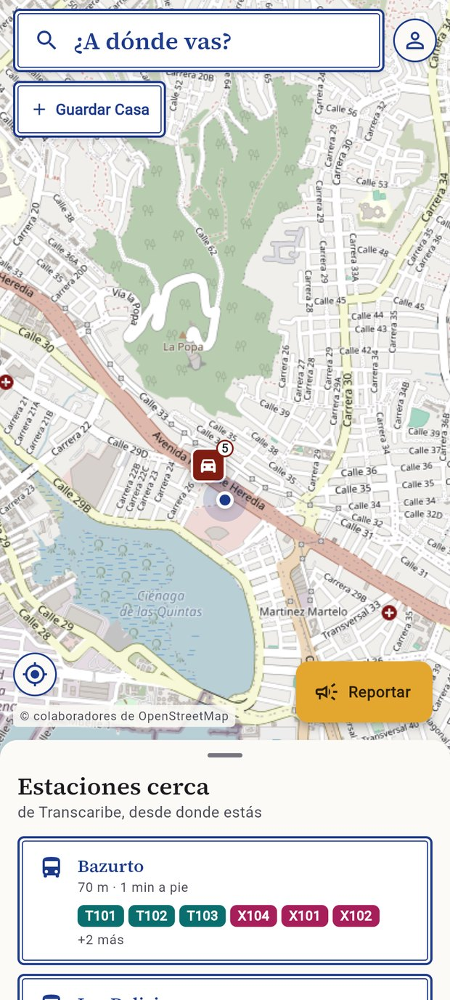
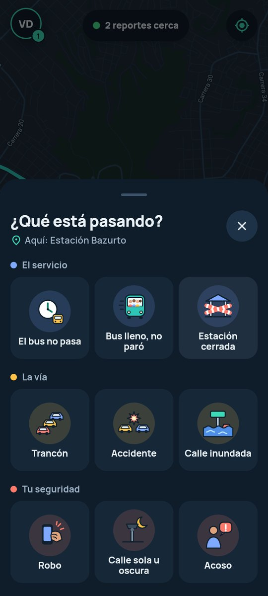
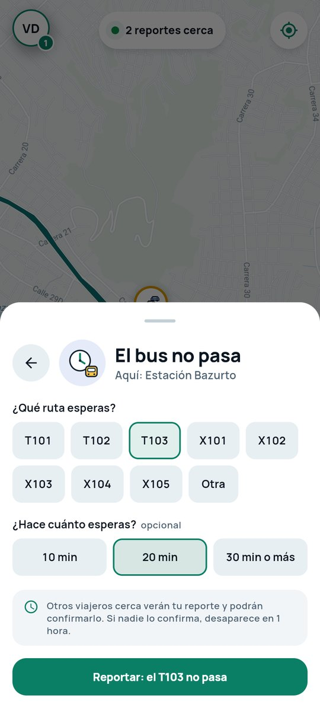
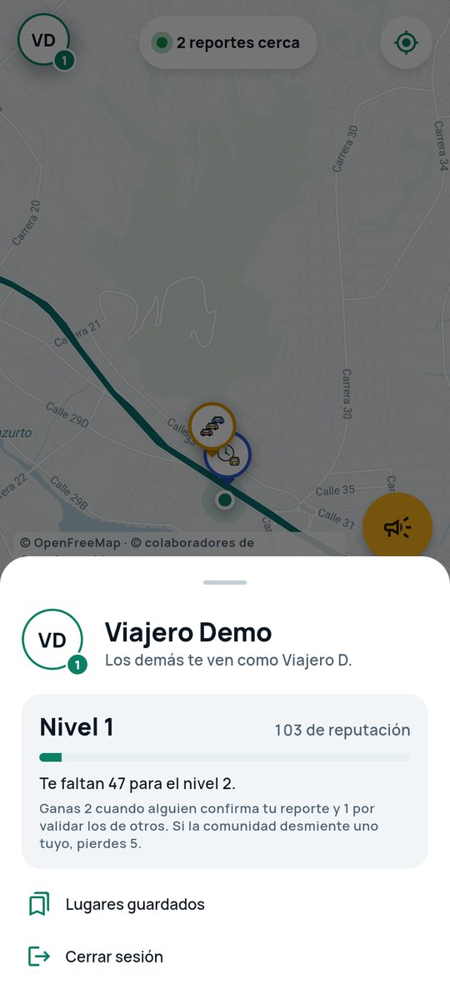
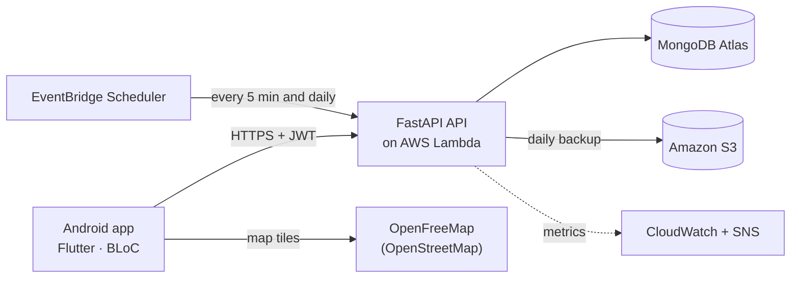

# Karta

[Español](README.md) · **English**

[](https://github.com/cmaestrei-dev/karta/actions/workflows/ci.yml)


**Karta is a free, open-source Android app for getting around on Transcaribe, the bus rapid transit system of Cartagena, Colombia.** It tells you how to get there, guides you on the bus to your stop, and estimates when the next bus will arrive from what riders themselves report. No ads, and it doesn't sell personal data.

<table>
  <tr>
    <td></td>
    <td></td>
    <td></td>
    <td></td>
  </tr>
</table>

<sub>Screenshots of the web build with demo data. The app is in Spanish and follows the phone's light or dark theme.</sub>

## What it does

**Plan the trip**
- Searches places in Cartagena and street addresses written the Colombian way («Calle 9 # 3-50»).
- Suggests Transcaribe routes, including transfers, by the criterion you pick: fastest, safest or no transfer.
- Only offers routes that run at your departure time, using the official schedules and public holidays.
- At stations, it tells you the platform module and direction («Board the T101 at module A1, towards the Centro»).

**Ride**
- Guides the trip step by step with GPS, even with the screen off.
- Tells you when to get off. At a curbside stop, «Ring the bell!» 200 m ahead.
- Notices when the bus leaves its route or stands still for too long, and asks whether it took a detour or broke down.
- Estimates arrival time and how crowded the bus is «according to N riders», and always says how old the data is.

**Community**
- Anyone can report in two steps: the bus isn't coming, it's full, a flooded street, a robbery…
- Other riders confirm or dismiss reports with «Is it still there?».
- Points are earned only when the community validates a contribution. Levels unlock visual profile frames: nothing is for sale.

**Privacy**
- Works without signing up: the phone's account asks for no name or email.
- Sharing where the bus is going is anonymous and expires after 5 minutes. Nobody's location history exists.
- Users can delete their account from the app.

## How it's built



What's worth a look in the code:

- **Hexagonal architecture.** The domain (`backend/src/domain`) depends on neither FastAPI nor MongoDB. Use cases and adapters live in separate layers.
- **Custom route planner.** It samples each route every 25 m and looks for transfers where two routes pass within 300 m of each other, using a Shapely STRtree spatial index. Risk is computed over a 500 m corridor around the route, queried with `$geoWithin` in MongoDB.
- **Real time without tracking anyone.** Sightings and shared trips don't store who sent them, and they expire on their own through TTL indexes.
- **Serverless deployment for USD 0:**
  - every deploy publishes a Lambda version and tests it before moving the `live` alias;
  - rolling back is one command;
  - a warmer reduces cold starts;
  - there's an encrypted daily backup to S3, CloudWatch alarms and a budget alert.
- **Security:**
  - Argon2id password hashing and JWT sessions;
  - per-IP rate limiting (IPv6 counted per /64) and per-action limits;
  - least-privilege IAM.
- **Privacy (Colombian data protection law, Ley 1581 of 2012):**
  - usage figures are published only when at least 10 distinct people stand behind them;
  - those people are counted with monthly HMAC fingerprints, without linking anyone's trips.
- **Quality:**
  - 310 automated tests: 169 backend tests with pytest and 141 app tests with Flutter, including accessibility and large text;
  - continuous integration on GitHub Actions and a probe that checks the API every 10 minutes;
  - a [quality-attribute audit](docs/plan-calidad.md) with its improvement plan (in Spanish).

## Status

Working prototype in testing. The API already runs on AWS. The app isn't on the Play Store yet: before opening it to the public, Karta is waiting for the official stop and schedule data. It requested them from Transcaribe and the Cartagena mayor's office through formal freedom-of-information petitions.

Today the data comes from OpenStreetMap (24 routes, 17 stations and 453 places), the published official schedules, and riders themselves.

## Run it locally

```bash
docker compose up --build          # API at http://localhost:8000 plus MongoDB, with demo data
cd frontend && flutter pub get
flutter run -d chrome              # the quickest way to see the app
```

The full guide covers running the backend without Docker, building the APK, the endpoints and the data model. It's in [docs/desarrollo.md](docs/desarrollo.md) (in Spanish).

## Documentation

The project docs are in Spanish.

| Topic | Document |
|---|---|
| Developer guide, endpoints and data model | [docs/desarrollo.md](docs/desarrollo.md) |
| AWS deployment | [docs/despliegue-aws.md](docs/despliegue-aws.md) |
| Quality attributes: audit and plan | [docs/plan-calidad.md](docs/plan-calidad.md) |
| Class, data and sequence diagrams | [docs/diagramas](docs/diagramas) |
| «Bahía» design system | [DESIGN.md](DESIGN.md) |
| Product and users | [PRODUCT.md](PRODUCT.md) |
| Transfers across the whole network | [docs/analisis-transbordos.md](docs/analisis-transbordos.md) |
| Route comparison with Google Maps and Moovit | [docs/comparacion-apps.md](docs/comparacion-apps.md) |

## Author

Karta started in 2026 as a course project for Internet Services Engineering at Universidad de Cartagena. It was created and is maintained by **Camilo Maestre Iglesias** ([@cmaestrei-dev](https://github.com/cmaestrei-dev)).

It is built with AI assistance (Claude Code): the author defines the product, the architecture and the priorities, and tests the builds on a real phone.

## Licenses

- The server (`backend/`) is under the **GNU AGPL 3.0 or later**.
- The app (`frontend/`) is under **Apache 2.0**.
- The documentation is under **CC BY 4.0**.

Data from OpenStreetMap (ODbL) and Cartagena Open Data (CC BY 4.0) keep their own licenses. Details are in [LICENSE.md](LICENSE.md). To contribute, read [CONTRIBUTING.md](CONTRIBUTING.md).
