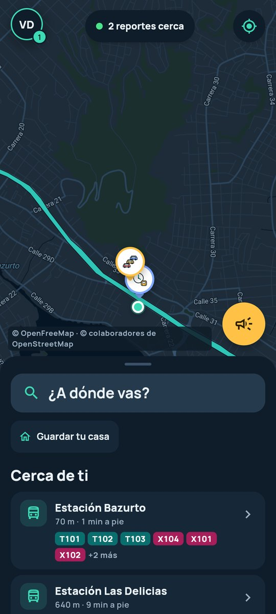
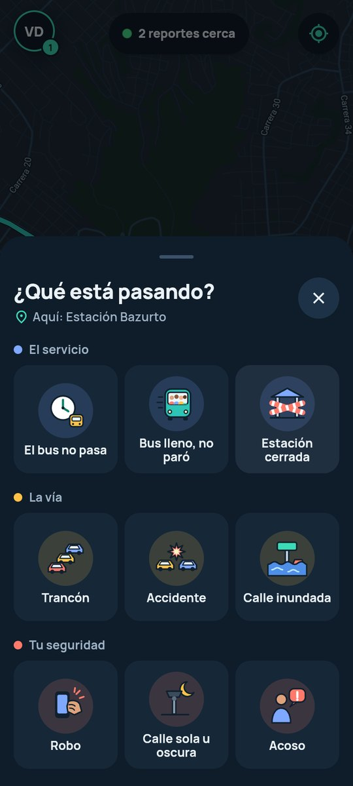
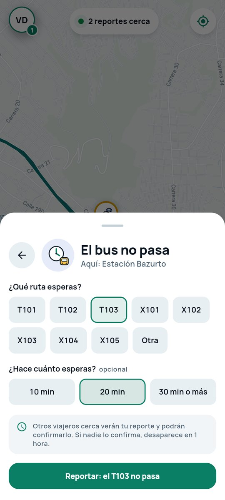
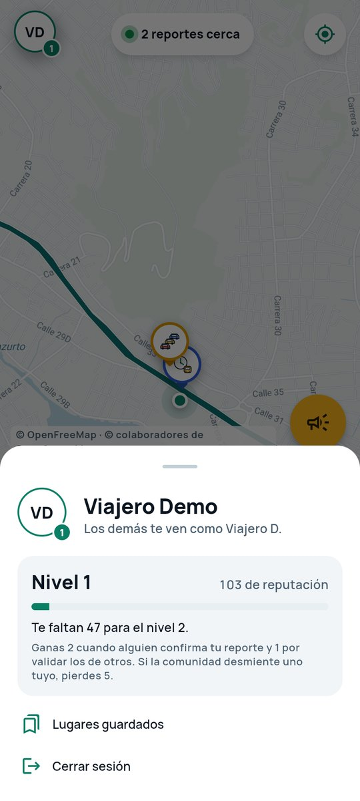

# Karta — Sistema de enrutamiento de transporte público

Proyecto de aula de **Ingeniería de Servicios de Internet**, Universidad de Cartagena (2026-2).

Karta ayuda al viajero de Cartagena a moverse en Transcaribe con menos incertidumbre: busca su destino,
le sugiere cómo llegar (caminata + ruta + caminata) con el riesgo de cada opción y muestra en el mapa lo
que reporta la comunidad (el servicio, la vía y la seguridad), que otros viajeros confirman o desmienten. El alcance del prototipo es el área urbana de
Cartagena de Indias.

## Estado actual

| Funcionalidad | Estado |
|---|---|
| Registro e inicio de sesión (JWT, sesión guardada en almacenamiento seguro) | ✅ |
| Reportar en dos pasos: 9 tipos ilustrados en 3 grupos y sus detalles («el T103 no pasa · 20 min») | ✅ requiere sesión |
| Ver los reportes vigentes en el mapa | ✅ cada tipo vive de 30 min a 12 h; cada confirmación lo renueva |
| «¿Sigue ahí?»: confirmar o desmentir reportes ajenos, reputación y niveles | ✅ un voto por viajero; dos «ya no está» seguidos lo retiran |
| Buscar un lugar de Cartagena o elegir el punto en el mapa | ✅ 453 lugares de OpenStreetMap |
| Rutas sugeridas de Transcaribe con su riesgo | ✅ 24 rutas y 17 estaciones de OpenStreetMap |
| Estaciones cercanas con sus rutas | ✅ |
| Lugares guardados (Casa, Trabajo…) | ✅ CRUD, máximo 10 por viajero |
| Límite de frecuencia de peticiones (registro, inicio de sesión, reportes y votos) | ✅ responde 429 con `Retry-After` |
| Viaje activo, avisos y posición de los buses según los viajeros | ⏳ fases 2 y 3 del [plan](docs/plan-reconstruccion.md) |

## Arquitectura

```
Flutter (BLoC) ──HTTP/JSON + Bearer JWT──▶ FastAPI ──PyMongo──▶ MongoDB
      │
      └──HTTPS──▶ teselas vectoriales de OpenFreeMap (datos de OpenStreetMap), con estilo propio «Bahía»
```

El backend sigue una arquitectura hexagonal (puertos y adaptadores):

| Carpeta | Contenido |
|---|---|
| `backend/src/domain` | Entidades, reglas de negocio (`reportes.py` con el catálogo y la validación comunitaria, `trip_planning.py`, `route_risk.py`, `geo.py`), puertos (`ports.py`) y esquemas Pydantic de la API. No depende de FastAPI ni de MongoDB |
| `backend/src/application` | Casos de uso: `AuthService`, `IncidentService`, `PlaceService` (buscador y lugares guardados) y `TripService` (rutas sugeridas, estaciones cercanas) |
| `backend/data`, `backend/scripts` | Rutas, estaciones y lugares importados de OpenStreetMap (`importar_osm.py`); se cargan al arrancar la API |
| `backend/src/infrastructure` | Adaptadores: FastAPI y routers, repositorios MongoDB, Argon2 + JWT, configuración |
| `frontend/lib/core` | Configuración y servicios compartidos (URL de la API, GPS, errores de la API), sistema de diseño «Bahía» (`design/`) y capa del mapa (`map/`) |
| `frontend/lib/features/<funcionalidad>` | `data` (repositorios HTTP), `domain` (modelos), `presentation` (BLoC y pantallas) |

### Modelo de datos (MongoDB)

| Colección | Documento | Índices |
|---|---|---|
| `users` | `email`, `password_hash` (Argon2id), `nombre`, `alias` («Ana P.»), `tipo_viajero`, `reputacion`, `terminos_aceptados_en`, `creado_en`, `lugares_guardados` (embebidos, máx. 10) | único en `email` |
| `incidents` | `reportado_por` (ObjectId), `grupo`, `tipo`, `detalles`, `lugar`, `ubicacion` (GeoJSON Point), `votos_si`, `votos_no`, `no_seguidos`, `creado_en`, `expira_en` | `2dsphere` en `ubicacion`; TTL en `expira_en` |
| `incident_votes` | `incidente`, `usuario`, `sigue` (sí / no), `creado_en`, `expira_en` | único en (`incidente`, `usuario`); TTL |
| `rate_limits` | `_id` = acción, clave y ventana; `conteo`, `expira_en` | TTL en `expira_en` |
| `places` | `nombre`, `tipo`, `ubicacion` (Point), `tokens` (palabras normalizadas) | `2dsphere`; `tokens` |
| `stations` | `nombre`, `ubicacion` (Point), `rutas` | `2dsphere` |
| `transit_routes` | `nombre`, `tipo`, `desde`, `hasta`, `geometria` (LineString) | `2dsphere` en `geometria` |

El riesgo de una ruta se calcula trazando un corredor de 500 m alrededor de la polilínea
(en UTM 18N, EPSG:32618, para medir en metros) y consultándolo con `$geoWithin` sobre el índice `2dsphere`.
Las rutas sugeridas parten de las rutas que pasan a menos de 800 m del origen y del destino (`$geoIntersects`),
eligen la mejor subida y bajada en cada una y se ordenan por tiempo más una penalización por riesgo.

Los diagramas de clases, del modelo de datos y de secuencia (PlantUML y PNG) están en [`docs/diagramas`](docs/diagramas).

## Puesta en marcha

### Opción A: Docker (recomendada)

Requiere Docker Engine con Compose. Desde la raíz del repositorio:

```bash
docker compose up --build
```

- API: <http://localhost:8000> (redirige a Swagger, en `/api/v1/docs`)
- MongoDB: `localhost:27017`, solo accesible desde el mismo equipo. Credenciales en `docker-compose.yml`

Al arrancar se crean los índices y se cargan datos de demostración: un usuario demo (credenciales en
`backend/.env.example`) y algunos incidentes en Cartagena. Los cambios en `backend/src` recargan la API solos.

### Opción B: instalación local

Requiere Python 3.12 y un MongoDB 7 u 8 (local o un clúster gratuito M0 de MongoDB Atlas).
Desde la carpeta `backend/` (los imports parten de `src.`, así que los comandos deben correr ahí):

```bash
python -m venv .venv
source .venv/bin/activate          # Windows: .venv\Scripts\activate
pip install -r requirements-dev.txt
cp .env.example .env               # Windows: copy .env.example .env — luego ajusta MONGO_URI y JWT_SECRET
python -m src.infrastructure.seed  # opcional: datos de demostración
uvicorn src.infrastructure.main:app --reload
```

### App Flutter

Desde la carpeta `frontend/`:

```bash
flutter pub get
flutter run -d chrome     # la forma más rápida de probar
flutter run -d linux      # escritorio Linux (requiere libsecret-1-dev)
```

La URL de la API se define con `--dart-define`; por defecto es `http://127.0.0.1:8000/api/v1`.

| Dónde corre la app | Cómo ejecutarla |
|---|---|
| Chrome o escritorio, en el mismo equipo que la API | `flutter run` sin parámetros extra |
| Emulador de Android | `flutter run --dart-define=API_BASE_URL=http://10.0.2.2:8000/api/v1` |
| Celular físico en la misma red Wi-Fi | ver la sección siguiente |

En modo debug, si el GPS no responde (común en Linux de escritorio) y no hay una ubicación conocida,
la app usa una coordenada de respaldo en Cartagena y lo avisa. En release nunca inventa la ubicación.

### Probar en un celular Android (APK de prueba)

El celular y el computador con la API deben estar en la misma red (sirve el hotspot del propio celular).

1. Levanta el backend con `docker compose up` (publica el puerto 8000 en la red local).
2. Averigua la IP del computador: `hostname -I` en Linux, `ipconfig` en Windows.
3. Compila el APK apuntando a esa IP:

   ```bash
   flutter build apk --debug --target-platform android-arm64 \
     --dart-define=API_BASE_URL=http://<IP-del-computador>:8000/api/v1
   ```

4. Instala `build/app/outputs/flutter-apk/app-debug.apk` en el celular (por cable con
   `adb install`, o copiándolo y permitiendo "instalar apps de origen desconocido").

Si la IP del computador cambia, hay que recompilar el APK. Si la app no conecta, revisa que el
firewall del computador permita conexiones entrantes al puerto 8000.

## Endpoints

| Método | Ruta | Sesión | Descripción |
|---|---|---|---|
| GET | `/api/v1/health` | — | Estado del servicio y de la base de datos |
| POST | `/api/v1/auth/register` | — | Registrar un viajero (exige `acepta_terminos: true`); devuelve el token. Máx. 10 por hora por IP |
| POST | `/api/v1/auth/login` | — | Iniciar sesión; devuelve un token Bearer (JWT). Máx. 10 por minuto por IP |
| GET | `/api/v1/users/me` | ✅ | Perfil del viajero autenticado, con su alias, reputación y nivel (1 a 5) |
| GET | `/api/v1/incidents/types` | — | Catálogo de reportes: grupos, tipos, preguntas y vigencia |
| POST | `/api/v1/incidents/` | ✅ | Reportar (`tipo`, `detalles`, `latitud`, `longitud`); el autor sale del token. Máx. 6 cada 10 min |
| GET | `/api/v1/incidents/` | — | Reportes vigentes, opcionalmente dentro de una caja (`lon_min`, `lat_min`, `lon_max`, `lat_max`) |
| GET | `/api/v1/incidents/{id}` | opcional | Detalle con el alias del autor; con sesión dice si es tuyo y cómo votaste |
| POST | `/api/v1/incidents/{id}/votes` | ✅ | «¿Sigue ahí?» (`sigue: true/false`). 403 si es tuyo, 409 si ya votaste. Máx. 30 cada 10 min |
| GET | `/api/v1/routes/?tipo=` | — | Rutas de Transcaribe con su trazado GeoJSON (para dibujarlas en el mapa) |
| POST | `/api/v1/routes/risk` | — | Calcular el riesgo de una ruta a partir de sus puntos (lat/lon) |
| POST | `/api/v1/routes/suggest` | — | Rutas sugeridas de Transcaribe entre dos puntos, con tramos GeoJSON y riesgo |
| GET | `/api/v1/places/search?q=` | — | Buscar lugares de Cartagena (sin tildes, por prefijo de palabra) |
| GET | `/api/v1/places/reverse?lat=&lon=` | — | Nombre del punto elegido en el mapa |
| GET | `/api/v1/stops/nearby?lat=&lon=` | — | Estaciones cercanas, con sus rutas y la distancia a pie |
| GET | `/api/v1/users/me/places` | ✅ | Listar los lugares guardados |
| POST | `/api/v1/users/me/places` | ✅ | Guardar un lugar (409 si ya hay 10) |
| PATCH | `/api/v1/users/me/places/{id}` | ✅ | Editar nombre, ícono o ubicación de un lugar propio |
| DELETE | `/api/v1/users/me/places/{id}` | ✅ | Eliminar un lugar propio |

Documentación interactiva (Swagger): <http://127.0.0.1:8000/api/v1/docs>. Para probar los endpoints
con sesión, inicia sesión, copia el `access_token` y pégalo en el botón **Authorize**.

## Pruebas

```bash
# Backend: las pruebas de integración necesitan MongoDB (docker compose up -d mongo)
cd backend
pytest

# Frontend
cd frontend
flutter analyze
flutter test
```

## Diseño

| Inicio | Reportar | Detalles del reporte | Perfil y nivel |
|---|---|---|---|
|  |  |  |  |

Capturas de la versión web con datos de demostración, en Estación Bazurto; las dos primeras en tema oscuro y las
otras dos en tema claro (la app sigue el tema del teléfono).

La app sigue el sistema de diseño «Bahía» (noche de bahía con verde agua, y su versión clara para el sol),
con mapa vectorial de estilo propio e ilustraciones para cada tipo de reporte:
[`DESIGN.md`](DESIGN.md) describe el sistema de diseño, [`PRODUCT.md`](PRODUCT.md) el contexto del producto y
[`docs/auditoria-diseno.md`](docs/auditoria-diseno.md) la auditoría de usabilidad que motivó el rediseño.
Los datos de rutas, estaciones, lugares y el mapa de fondo son © colaboradores de OpenStreetMap (ODbL);
las teselas vectoriales las sirve OpenFreeMap.

## Convenciones

- Commits con [Conventional Commits](https://www.conventionalcommits.org/es/): `feat(incidents): ...`, `fix(routing): ...`.
- Los secretos van en `backend/.env`, que nunca se sube al repositorio; `backend/.env.example` documenta las variables.
