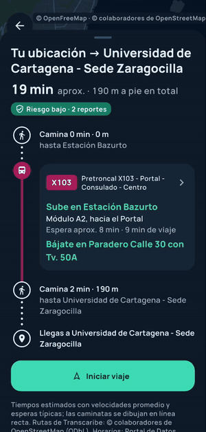
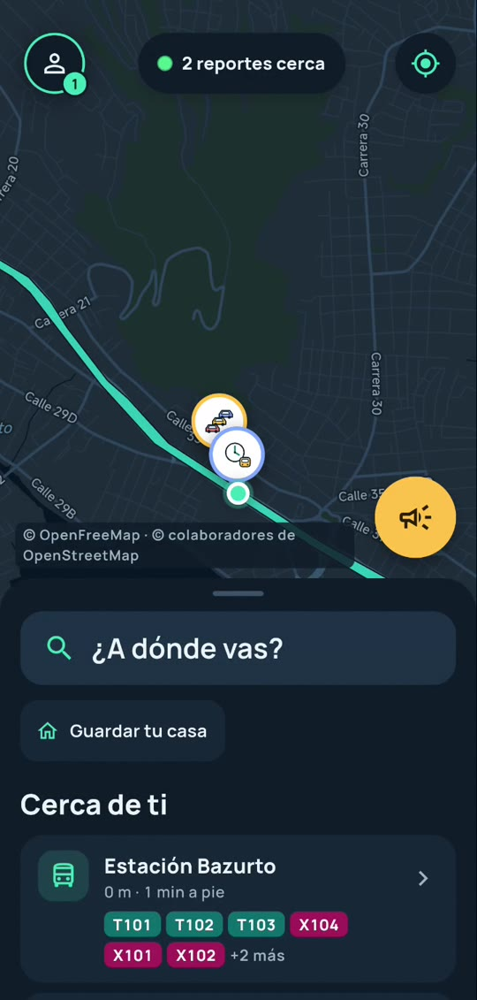
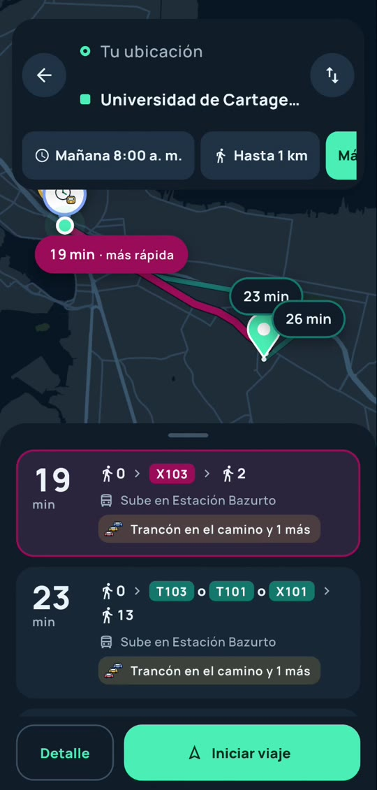
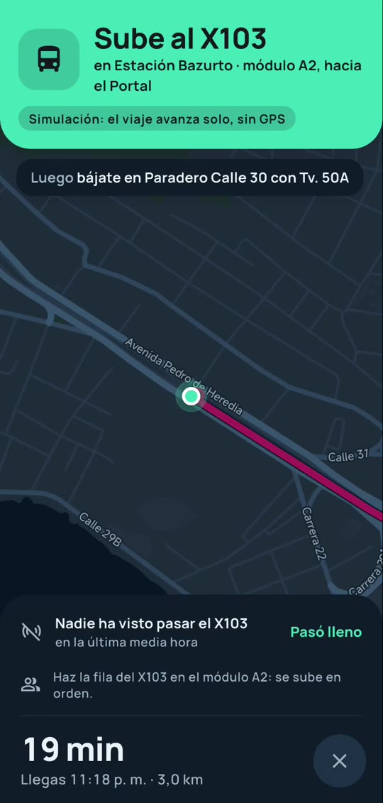
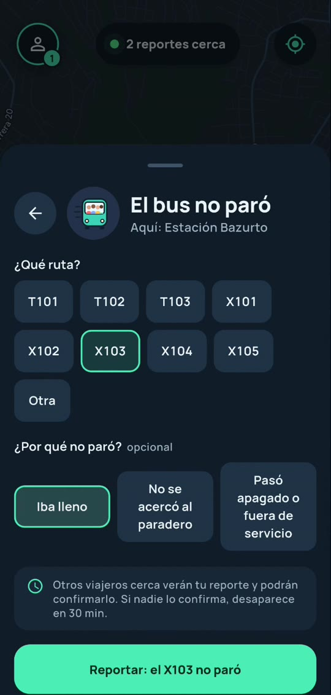
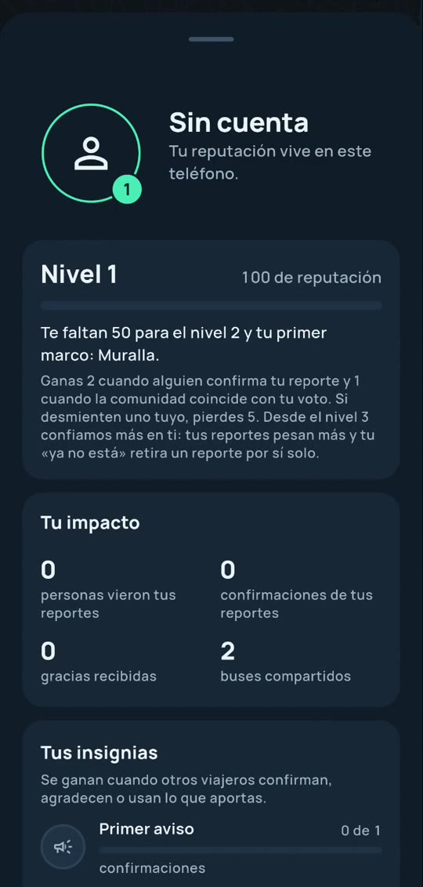
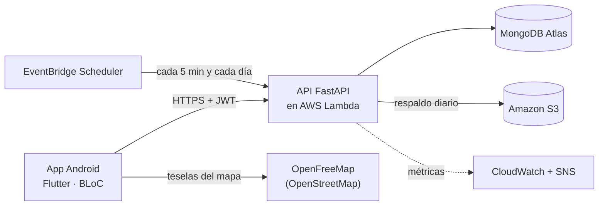

# Karta

**Español** · [English](README.en.md)

[](https://github.com/cmaestrei-dev/karta/actions/workflows/ci.yml)


**Karta es una app Android gratuita y de código abierto para moverse en Transcaribe, el sistema de buses de Cartagena de Indias.** Te dice cómo llegar, te guía en el bus hasta tu parada y estima cuándo pasa el próximo bus con lo que reportan los mismos pasajeros. No tiene anuncios ni vende datos personales.

<p align="center"></p>

<table>
  <tr>
    <td></td>
    <td></td>
    <td></td>
  </tr>
  <tr>
    <td></td>
    <td></td>
    <td></td>
  </tr>
</table>

<sub>Grabado en un teléfono Android con una versión de demostración: datos de demostración y viaje simulado, que la app indica en pantalla. La app sigue el tema claro u oscuro del teléfono.</sub>

## Qué hace

**Planear el viaje**
- Busca lugares de Cartagena y direcciones con la nomenclatura colombiana («Calle 9 # 3-50»).
- Sugiere rutas de Transcaribe con transbordos, según el criterio que elijas: más rápida, más segura o sin transbordo.
- Solo propone rutas que operan a la hora de salida, con los horarios oficiales y los festivos.
- En las estaciones dice el módulo y el sentido («Sube al T101 en el módulo A1, hacia el Centro»).

**Viajar**
- Guía el viaje paso a paso con el GPS, incluso con la pantalla apagada.
- Avisa cuándo bajarse. En un paradero, «¡Toca el timbre!» a 200 m.
- Nota cuando el bus se sale de su recorrido o lleva mucho rato quieto, y pregunta si se desvió o se varó.
- Estima la llegada y qué tan lleno va el bus «según N viajeros», y siempre dice de cuándo es el dato.

**La comunidad**
- Cualquiera reporta en dos pasos: el bus no pasa, va lleno, una calle inundada, un robo…
- Los demás confirman o desmienten con «¿Sigue ahí?».
- Los puntos solo llegan cuando la comunidad valida el aporte. Los niveles dan marcos visuales: nada se compra.

**La privacidad**
- Se usa sin registrarse: la cuenta del teléfono no pide nombre ni correo.
- Compartir dónde va el bus es anónimo y vence a los 5 minutos. No existe un historial de ubicaciones de nadie.
- La cuenta se puede borrar desde la app.

## Cómo está hecho



Lo que vale la pena mirar en el código:

- **Arquitectura hexagonal.** El dominio (`backend/src/domain`) no depende de FastAPI ni de MongoDB. Los casos de uso y los adaptadores van en capas aparte.
- **Planificador de rutas propio.** Muestrea cada ruta cada 25 m y busca transbordos donde dos rutas pasan a menos de 300 m, con un índice espacial STRtree de Shapely. Calcula el riesgo con un corredor de 500 m alrededor del recorrido, consultado con `$geoWithin` en MongoDB.
- **Tiempo real sin vigilar a nadie.** Los avistamientos y los viajes compartidos no guardan quién los envió, y vencen solos con índices TTL.
- **Despliegue serverless por USD 0:**
  - cada despliegue publica una versión de Lambda y la prueba antes de moverle el alias `live`;
  - volver atrás es un comando;
  - un calentador reduce los arranques en frío;
  - hay respaldo diario cifrado en S3, alarmas en CloudWatch y un presupuesto con aviso.
- **Seguridad:**
  - contraseñas con Argon2id y sesiones con JWT;
  - límite de peticiones por IP (las IPv6 se cuentan por /64) y por acción;
  - permisos IAM mínimos.
- **Privacidad (Ley 1581 de 2012):**
  - las cifras de uso solo se publican cuando hay al menos 10 personas distintas;
  - esas personas se cuentan con huellas HMAC mensuales, sin enlazar los viajes de nadie.
- **Calidad:**
  - 310 pruebas automatizadas: 169 del backend con pytest y 141 de la app con Flutter, que incluyen accesibilidad y letra grande;
  - integración continua en GitHub Actions y una sonda que revisa la API cada 10 minutos;
  - una [auditoría de atributos de calidad](docs/plan-calidad.md) con su plan de mejora.

## Estado

Prototipo funcional en pruebas. La API ya corre en AWS. La app todavía no está en la Play Store: antes de abrirla al público, Karta espera los datos oficiales de paraderos y horarios, que pidió a Transcaribe y a la Alcaldía de Cartagena mediante derechos de petición de acceso a la información.

Hoy los datos vienen de OpenStreetMap (24 rutas, 17 estaciones y 453 lugares), de los horarios oficiales publicados y de los mismos pasajeros.

## Correrlo en tu equipo

```bash
docker compose up --build          # API en http://localhost:8000 y MongoDB, con datos de demostración
cd frontend && flutter pub get
flutter run -d chrome              # la forma más rápida de ver la app
```

La guía completa explica cómo levantar el backend sin Docker, compilar el APK, los endpoints y el modelo de datos. Está en [docs/desarrollo.md](docs/desarrollo.md).

## Documentación

| Tema | Documento |
|---|---|
| Guía de desarrollo, endpoints y modelo de datos | [docs/desarrollo.md](docs/desarrollo.md) |
| Despliegue en AWS | [docs/despliegue-aws.md](docs/despliegue-aws.md) |
| Atributos de calidad: auditoría y plan | [docs/plan-calidad.md](docs/plan-calidad.md) |
| Diagramas de clases, datos y secuencia | [docs/diagramas](docs/diagramas) |
| Sistema de diseño «Bahía» | [DESIGN.md](DESIGN.md) |
| Producto y usuarios | [PRODUCT.md](PRODUCT.md) |
| Transbordos de toda la red | [docs/analisis-transbordos.md](docs/analisis-transbordos.md) |
| Comparación de rutas con Google Maps y Moovit | [docs/comparacion-apps.md](docs/comparacion-apps.md) |

## Autor

Karta nació en 2026 como proyecto de aula de Ingeniería de Servicios de Internet en la Universidad de Cartagena. La creó y la mantiene **Camilo Maestre Iglesias** ([@cmaestrei-dev](https://github.com/cmaestrei-dev)).

Se desarrolla con asistencia de IA (Claude Code): el autor define el producto, la arquitectura y las prioridades, y prueba las versiones en un teléfono real.

## Licencias

- El servidor (`backend/`) va bajo la **GNU AGPL 3.0 o posterior**.
- La app (`frontend/`) va bajo la **Apache 2.0**.
- La documentación va bajo **CC BY 4.0**.

Los datos de OpenStreetMap (ODbL) y de Datos Abiertos de Cartagena (CC BY 4.0) conservan su licencia. Los detalles están en [LICENSE.md](LICENSE.md). Para aportar, lee [CONTRIBUTING.md](CONTRIBUTING.md).
